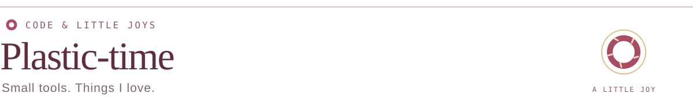

<picture>
  <source media="(max-width: 600px) and (prefers-color-scheme: dark)" srcset="assets/title-mobile-dark.svg">
  <source media="(max-width: 600px) and (prefers-color-scheme: light)" srcset="assets/title-mobile-light.svg">
  <source media="(prefers-color-scheme: dark)" srcset="assets/title-dark.svg">
  <source media="(prefers-color-scheme: light)" srcset="assets/title-light.svg">
  
</picture>

  

  GAME TOOLS &nbsp; / &nbsp; DESKTOP COMPANIONS &nbsp; / &nbsp; EXPERIMENTS

  <a href="#selected-projects">Projects</a> &nbsp; · &nbsp;
  <a href="#contributions">Contributions</a> &nbsp; · &nbsp;
  <a href="https://github.com/Plastic-time?tab=repositories">Repositories</a>

## About

Hi, I'm <strong>Plastic-time</strong>.

I make tools for the games I play and little companions for my desktop. This is where those projects live.

## Selected projects

<table>
  <tr>
    <td width="50%" valign="top">
      <h3><a href="https://github.com/Plastic-time/warthunder-research-calculator">War Thunder Planner</a></h3>
      
Pick a vehicle. Plan your research path. Know the RP and Silver Lions you need.

      
GAME TOOL · WEB / WINDOWS

      
<a href="https://plastic-time.github.io/warthunder-research-calculator/">Try it ↗</a> &nbsp; <a href="https://github.com/Plastic-time/warthunder-research-calculator">Code ↗</a>

    </td>
    <td width="50%" valign="top">
      <h3><a href="https://github.com/Plastic-time/Shinobu-Oshino-pet">Shinobu Companion</a></h3>
      
A quiet desktop companion, with an occasional blink. An unofficial fan project.

      
DESKTOP PET · GPT / WINDOWS

      
<a href="https://github.com/Plastic-time/Shinobu-Oshino-pet/releases">Meet her ↗</a> &nbsp; <a href="https://github.com/Plastic-time/Shinobu-Oshino-pet">Code ↗</a>

    </td>
  </tr>
</table>

## Contributions

<a href="https://github.com/Plastic-time?tab=overview#year-list-container">
  <picture>
    <source media="(prefers-color-scheme: dark)" srcset="assets/contributions-dark.svg">
    <source media="(prefers-color-scheme: light)" srcset="assets/contributions-light.svg">
    
  </picture>
</a>

  

Thanks for stopping by. Enjoy the little things.

